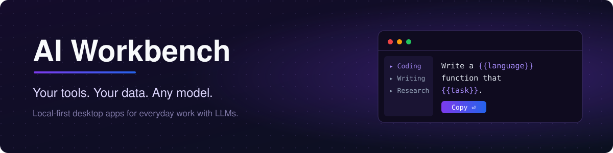

 

**A growing collection of local-first desktop apps for people who work with LLMs every day.**

[The idea](#-the-idea) · [Apps](#-apps) · [Principles](#-principles) · [Coming next](#-coming-next)

---

## 💡 The idea

ChatGPT, Claude, Gemini, local models — the chat window keeps changing.
What stays the same is **your work around it**: the prompts you reuse, the
context you paste again and again, the notes and results you want to keep.

Today that work lives in random notes, browser tabs, and copy-paste.

**AI Workbench** is a set of small, focused desktop apps that give this work a
proper home:

- 🏠 **On your machine** — your data is stored locally, not in someone else's cloud.
- 🔌 **Independent of any model** — switch LLMs without losing your workflow.
- 🎯 **One job per app** — each tool does one thing and does it well.

---

## 🧰 Apps

<table>
<tr>
<td valign="top">

### ✍️ [YourPrompts](https://github.com/NicolasYusim/YourPrompts)

**Turn scattered prompts into a library you can actually use.**

A local-first desktop app for organizing, templating, and reusing prompts across
ChatGPT, Claude, Gemini, and any other LLM.

| | |
| :---: | --- |
| `{{ }}` | **Dynamic templates** — write once, fill `{{variables}}` through generated input fields |
| 📁 | **Folders & tags** — keep every prompt organized and searchable |
| ⚡ | **Find in seconds** — fill in a template and copy the finished prompt |
| 🔒 | **Local-first** — your prompt library stays on your device |
| 🌍 | **Localized** — English · Français · Русский |

**Download:**

**[→ Open repository](https://github.com/NicolasYusim/YourPrompts)**

</td>
</tr>
</table>

---

## 📐 Principles

Every app in this collection follows the same four rules:

<table>
<tr>
<td align="center" width="25%">🔒 <b>Local-first</b> Your data lives on your device. No account required.</td>
<td align="center" width="25%">🔌 <b>Model-agnostic</b> Works with ChatGPT, Claude, Gemini, local models — whatever you use.</td>
<td align="center" width="25%">🖥️ <b>Cross-platform</b> macOS, Windows, and Linux from day one.</td>
<td align="center" width="25%">🎯 <b>Do one thing well</b> Small focused tools instead of one bloated platform.</td>
</tr>
</table>

---

## 🗺️ Coming next

YourPrompts is the first app. More tools for everyday AI work are on the way.

<table>
<tr>
<td align="center" width="33%">✅ <b>YourPrompts</b> Prompt library & templates  <a href="https://github.com/NicolasYusim/YourPrompts">Available</a></td>
<td align="center" width="33%">🔜 <b>Next app</b> In progress  Coming soon</td>
<td align="center" width="33%">💭 <b>Your idea?</b> What AI workflow annoys you most?  <a href="https://github.com/NicolasYusim/YourPrompts/issues">Suggest it</a></td>
</tr>
</table>

---

Built by <a href="https://github.com/NicolasYusim">@NicolasYusim</a> · If an app here saves you time, a ⭐ on its repository helps a lot.

